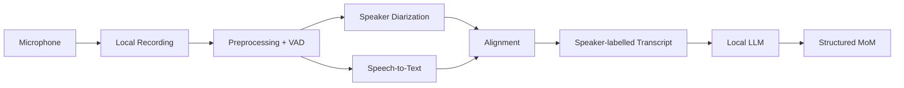

<div align="center">

# Cadence

**Local-first meeting transcription and minutes-of-meeting, entirely on your laptop.**

No cloud STT. No cloud LLM. No telemetry. No internet required after setup.

[](LICENSE)
[](#getting-started)
[](#project-status)
[](https://tauri.app)
[](https://www.rust-lang.org)

</div>

---

Cadence records a physical meeting from a microphone and, entirely on the same machine, turns it into a speaker-labelled transcript and a structured Minutes of Meeting (MoM) — decisions, action items, open questions, risks. Nothing leaves the laptop: no audio, no transcript, and no meeting content is ever sent to a cloud API or a remote server.

It's built for real-world mixed-language meetings: **English, Tamil, and code-switched "Tanglish" within the same sentence** are all first-class, not an afterthought.

> **Why local-first?** Meeting audio is some of the most sensitive data an organization produces — strategy, personnel decisions, unreleased plans. Cadence's answer is architectural, not a privacy policy: the AI runtime is Rust-orchestrated native binaries only, so there is no cloud dependency to misconfigure and no telemetry to opt out of.

## Features

- 🎙️ **Local recording** — enumerate and pick any Windows input device (default mic, USB conference mic, headset), with live level metering and disconnect/clipping warnings.
- 📝 **Local speech-to-text** — multilingual, code-switch-aware transcription via whisper.cpp / sherpa-onnx.
- 🗣️ **Local speaker diarization** — `Person 1`, `Person 2`, … labels without identifying real people.
- 🧠 **Local LLM meeting minutes** — summary, decisions, action items, open questions, and risks, each grounded in transcript evidence with timestamps — hallucination controls keep speculation from becoming a "decision."
- 🔍 **Searchable history** — browse past meetings, search within a transcript, jump to any timestamp and replay the audio.
- 📤 **Export** — Markdown and JSON today, PDF/DOCX planned.
- 🧩 **Model management** — install, verify, and remove local STT/LLM/diarization models from Settings, with SHA-256 integrity checks; no manual setup script required.
- ⚖️ **Adapts to your machine** — detects available RAM and picks smaller/faster models and context sizes on a 16 GB laptop, larger ones on a 32 GB machine, automatically.
- 🔌 **Offline by design** — once models are installed, disconnect the internet and everything still works.

STT/diarization/LLM model choices are still provisional pending real benchmarks on this project's own (including Tamil/Tanglish) audio — see [docs/model-benchmark.md](docs/model-benchmark.md).

## How it works



Every stage runs as a Rust-orchestrated native process on the same machine — no stage ever makes a network call.

## Tech stack

| Layer | Choice |
|---|---|
| Desktop shell | [Tauri 2](https://tauri.app) |
| UI | React 19 + TypeScript |
| Native layer | Rust (audio capture via `cpal`, process orchestration, storage) |
| Speech-to-text | whisper.cpp / sherpa-onnx (Whisper ONNX) |
| Speaker diarization | ONNX-based offline diarization (sherpa-onnx class) |
| Meeting minutes | llama.cpp, local GGUF models (Qwen3, Gemma 3 candidates) |

No Python, PyTorch, Docker, or WSL — at development time or at runtime. See [docs/architecture.md](docs/architecture.md) for the reasoning behind each decision.

## Getting started

**Prerequisites:** Node.js, a Rust toolchain (`cargo`/`rustc`), Windows 11.

```powershell
npm install
npm run tauri dev      # runs the full desktop app (Vite + Rust)
```

Other useful commands:

```powershell
npm run dev             # Vite frontend only, no Tauri APIs
npm run build            # typecheck + production frontend build
npm run tauri build      # production Windows installer
cargo test                # from src-tauri/ — Rust unit tests
```

## Project structure

```text
Cadence/
├── src/                    # React UI
├── src-tauri/              # Rust: native commands, audio capture, AI pipeline orchestration
├── docs/                   # architecture, model selection, and other living decision docs
├── meeting-ai-app-PLAN.md  # authoritative project spec (objective, constraints, phases)
├── CLAUDE.md / AGENTS.md   # standing instructions for coding agents
└── LICENSE
```

## Project status

**Pre-alpha, actively in development.** The full local pipeline — recording, STT, diarization, alignment, MoM generation, history, export, and model management — is implemented, and now adapts its model choices to the machine's available RAM (16 GB vs. 32 GB). What's still open: this round of work hasn't been compiled or run in the environment that wrote it, and the STT/diarization/LLM model and threshold choices are still provisional, pending real benchmarks (harness now exists — see [docs/model-benchmark.md](docs/model-benchmark.md)) rather than validated defaults. Nothing here is ready to run an unattended meeting yet.

See [meeting-ai-app-PLAN.md](meeting-ai-app-PLAN.md) §38 for the full phase-by-phase roadmap (audio → STT benchmark → diarization benchmark → alignment → LLM benchmark → MoM → UI → packaging), and [docs/models.md](docs/models.md) for model benchmark results as they land.

## Documentation

| Doc | Purpose |
|---|---|
| [meeting-ai-app-PLAN.md](meeting-ai-app-PLAN.md) | Master spec: objective, constraints, schemas, UI, phases |
| [docs/architecture.md](docs/architecture.md) | Repo layout and key technical decisions |
| [docs/models.md](docs/models.md) | STT/LLM/diarization candidates and benchmark results |
| [docs/model-benchmark.md](docs/model-benchmark.md) | `bench_cli` usage and the (currently empty) Phase 2/3/6/14 results template |
| [docs/performance.md](docs/performance.md) | Per-stage timing/RAM measurements and the §29 budget |
| [docs/privacy.md](docs/privacy.md) | What's captured, what never leaves the machine, logging, deletion, model integrity |
| [CLAUDE.md](CLAUDE.md) / [AGENTS.md](AGENTS.md) | Standing instructions for coding agents working in this repo |

## Contributing

Contributions are welcome, especially around STT/diarization benchmarking, multilingual (Tamil/Tanglish) test audio, and the local LLM pipeline. Before opening a PR:

1. Read [meeting-ai-app-PLAN.md](meeting-ai-app-PLAN.md) — it's the authoritative spec, and changes should trace back to it.
2. Keep the runtime cloud-free: no calls to Claude/OpenAI/Azure/Gemini or any other hosted AI API from the shipped app, and no Python/PyTorch in the AI pipeline (native binaries only — see [docs/architecture.md](docs/architecture.md)).
3. Never commit confidential meeting recordings, and preserve raw pipeline artifacts (`original.wav`, `stt.json`, `diarization.json`) separately from derived output.
4. Open an issue for anything beyond a small fix, so the approach can be discussed against the current phase before code is written.

## License

[MIT](LICENSE) © 2026 Karthik Palani
