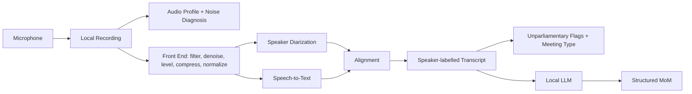

<div align="center">


# Cadence

**Local-first meeting transcription and minutes-of-meeting, entirely on your laptop.**

No cloud STT. No cloud LLM. No telemetry. No internet required after setup.

[](LICENSE)
[](#building-from-source)
[](#project-status)
[](https://tauri.app)
[](https://www.rust-lang.org)
[](#contributing)

[Features](#features) · [How it works](#how-it-works) · [Building from source](#building-from-source) · [Docs](#documentation) · [Contributing](#contributing)

</div>

---

Cadence records a physical meeting from a microphone and, on that same machine, turns it into a speaker-labelled transcript and a structured Minutes of Meeting — decisions, action items, open questions, risks. Meeting audio is some of the most sensitive data an organization produces, so the answer here is architectural rather than a privacy policy: the AI runtime is Rust-orchestrated native binaries only, so there is no cloud dependency to misconfigure and no telemetry to opt out of.

It is built for real-world mixed-language meetings: **English, Tamil, and code-switched "Tanglish" within the same sentence** are all first-class, not an afterthought.

## Features

- 🎙️ **Local recording** — enumerate and pick any Windows input device (default mic, USB conference mic, headset), with live level metering and disconnect/clipping warnings.
- 🎚️ **Audio clean-up before transcription** — a GTCRN speech denoiser (part of the standard install, on by default), then a speech-gated leveler and a compressor that bring the far end of the meeting table up towards the person nearest the mic. If the denoiser is missing or fails, model-free noise reduction stands in for it; a missing model never costs a meeting.
- 📊 **Tells you what was wrong with the recording** — levels, clipping and speech-band SNR, a quality score, and a named cause for the background noise (mains hum, fan, rumble, hiss, typing, room echo, other voices) with advice for next time. Signal processing, not a model — it works on a fresh install.
- 📝 **Local speech-to-text** — multilingual, code-switch-aware transcription via whisper.cpp, with Silero voice activity detection splitting the recording so each block gets its own language detection.
- 🗣️ **Local speaker diarization** — `Person 1`, `Person 2`, … labels without identifying real people, with word-level timestamps used to split a turn when two people talk inside one transcribed segment.
- 🧠 **Local LLM meeting minutes** — summary, decisions, action items, open questions and risks, each grounded in transcript evidence with timestamps; hallucination controls keep speculation from becoming a "decision". When masking is on, the model is shown the masked transcript rather than being trusted not to quote what it read.
- 🏷️ **Meeting type and topic tags** — worked out from the transcript by counting words, not by asking the LLM, so the same meeting classifies the same way every time and on every machine.
- 🤐 **Unparliamentary-language handling** — flag, mask (`f***`) or expunge profanity in the transcript, its exports, and the minutes. Detection *annotates*; it never rewrites `transcript.json`, so the policy is adjustable after the fact and a wrong flag is reversible. Terms are an editable word list, not code.
- 🔍 **Searchable history** — browse past meetings, search within a transcript, jump to any timestamp and replay the audio.
- 📤 **Export** — Markdown and JSON today, PDF/DOCX planned.
- 🧩 **Model management** — the native runtimes (whisper.cpp, llama.cpp, sherpa-onnx) ship inside the signed installer, so first-run setup downloads model data only: a consent-gated screen that lists every download before anything is fetched, then install, verify, reinstall and clean up from Settings. SHA-256 digests are recorded at install; verifying a runtime checks every file in its folder. Downloads run one at a time and never during a recording or while a meeting is processing.
- ⚖️ **One model set, 16 GB minimum** — every machine runs the same models (Whisper small, Qwen3-8B), so a meeting is summarised the same way on any machine; only thread counts adapt to the CPU. Before writing minutes it checks free RAM, and if there is not enough, it says how much to free and keeps the transcript safe.

## How it works



The front end runs in a fixed order — DC removal, high-pass, noise reduction (GTCRN, or the model-free fallback, never both), leveler, compressor, normalize — because each stage would otherwise fight the next: the gain stages must not pump room tone upwards, the slow leveler evens out near and far talkers before the compressor catches the fast peaks, and normalize must stay the one thing that sets the final level.

Every stage runs as a Rust-orchestrated native process on the same machine — no stage ever makes a network call. Raw artifacts (`original.wav`, `stt.json`, `diarization.json`) are written before the next stage runs and kept separate from derived output, so a late failure never costs earlier work. The profiling, classification and flagging stages are all read-only over those artifacts and write their own files beside them; none of them ever edits the recording or the transcript text.

## Tech stack

| Layer | Choice |
|---|---|
| Desktop shell | [Tauri 2](https://tauri.app) |
| UI | React 19 + TypeScript + Vite |
| Native layer | Rust (audio capture via `cpal`, process orchestration, SQLite storage) |
| Speech-to-text | [whisper.cpp](https://github.com/ggml-org/whisper.cpp), Whisper small |
| Speaker diarization, denoising, VAD | ONNX models (pyannote segmentation, WeSpeaker, GTCRN, Silero) run by [sherpa-onnx](https://github.com/k2-fsa/sherpa-onnx) |
| Meeting minutes | [llama.cpp](https://github.com/ggml-org/llama.cpp), Qwen3-8B Q4_K_M (GGUF); other models are bench-only candidates |

No Python, PyTorch, Docker or WSL — at development time or at runtime. [docs/architecture.md](docs/architecture.md) has the reasoning behind each decision.

## Building from source

Cadence targets **Windows 11 (x64)**. Everything below runs in PowerShell from the repository root.

### 1. Prerequisites

| Requirement | Notes |
|---|---|
| **Windows 11 (x64)** | Windows 10 21H2+ likely works but is untested |
| **Node.js 20 LTS or newer** | [nodejs.org](https://nodejs.org) — ships the `npm` used below |
| **Rust (stable, MSVC toolchain)** | Install via [rustup](https://rustup.rs); confirm with `rustup default stable-x86_64-pc-windows-msvc` |
| **Microsoft C++ Build Tools** | [Visual Studio Build Tools](https://visualstudio.microsoft.com/visual-cpp-build-tools/) with the *Desktop development with C++* workload — required by the MSVC linker and by `rusqlite`'s bundled SQLite |
| **WebView2 Runtime** | Preinstalled on Windows 11; otherwise [download it](https://developer.microsoft.com/microsoft-edge/webview2/) |

Verify with `node --version` (v20 or newer), `cargo --version` and `rustc --version` before building.

### 2. Clone and install

```powershell
git clone https://github.com/karthik1710/Cadence.git
cd Cadence
npm install
```

The first `cargo` build compiles the whole Tauri dependency tree and takes several minutes; later builds are incremental.

### 3. Install the AI models

An installed Cadence carries its three native runtimes — whisper.cpp, llama.cpp and sherpa-onnx — inside the installer, in `runtimes\` next to the app, so it never downloads an executable. It ships **no model weights**, though: they are data files of several gigabytes, installed afterwards. A source checkout has no runtimes until `scripts\prepare-runtimes.ps1` runs (step 5 does that for you), so in development they are downloaded like the models. Either launch the app, which opens on a setup screen listing every missing download and its size and installs them one at a time after one click (recommended; **Settings → Models** installs, verifies or reinstalls single items later), or run the dev-time script:

```powershell
.\scripts\setup-models.ps1
```

Both install into `%APPDATA%\com.cadence.app\models\` — one folder per runtime when the runtimes are not bundled (`bin\whisper\`, `bin\llama\`, `bin\sherpa\`, because whisper.cpp and llama.cpp ship same-named DLLs from different versions), plus `stt\`, `llm\`, `diarization\`, `denoise\` and `vad\` — the same location the shipped app resolves at runtime. The script is safe to re-run; every step is skipped if its output already exists. This is the only step that needs an internet connection — after it completes, the app runs fully offline.

### 4. Run in development

```powershell
npm run tauri dev        # full desktop app: Vite on :1420 + the Rust backend
npm run dev              # frontend only — no Tauri APIs available
```

### 5. Build a production bundle

```powershell
npm run tauri build      # local test build; warns about anything left unsigned
npm run release          # release build; fails unless every binary is signed
```

Before bundling, Tauri runs `scripts\prepare-runtimes.ps1`. It downloads the three pinned runtime release archives into `vendor\cache\`, refuses any whose SHA-256 differs from the pin, keeps only the executables Cadence launches plus their DLLs, signs them, and records a SHA-256 for every shipped file in `vendor\runtimes\manifest.json` (Settings → Models → Verify checks the installed copy against it). Signing identities, timestamping and how to check a finished installer are in [docs/release.md](docs/release.md).

Artifacts land in `src-tauri/target/release/`: `Cadence.exe` and `bundle/nsis/Cadence_<version>_x64-setup.exe`, a per-user installer that installs to `%LOCALAPPDATA%\Cadence` with no administrator rights. The release profile uses `opt-level = 3`, LTO and a single codegen unit, so a clean release build is noticeably slower than a debug one; it is also the profile the processing-time budget in [docs/benchmarks.md](docs/benchmarks.md) assumes.

### 6. Checks and headless tools

```powershell
npm run build                 # tsc typecheck + production frontend build

cd src-tauri
cargo build                   # Rust-only build
cargo test                    # Rust unit tests (pipeline modules) + the offline-guarantee suite

# headless pipeline run: audio → preprocess → diarize → STT → align → MoM
cargo run --bin pipeline_cli -- <audio.wav> [out-dir]

# benchmark harness; prints Markdown tables for docs/benchmarks.md
cargo run --release --bin bench_cli -- <stt|diarize|llm|full> <input> [options]

# baseline regression test against captioned clips (fetch them once with scripts\fetch-baseline-clips.ps1)
cargo run --release --bin bench_cli -- baseline
```

There is no ESLint/Prettier config and no JS test runner: `npm run build` is the frontend check, `cargo test` the backend one.

### Troubleshooting

| Symptom | Fix |
|---|---|
| `link.exe not found`, or linker errors | Install the *Desktop development with C++* workload in Visual Studio Build Tools |
| `cargo run` can't determine which binary to run | The crate has multiple binaries; `Cargo.toml` sets `default-run = "app"` — don't remove it |
| App starts but every pipeline stage errors | Models aren't installed — run the Model Manager or `scripts\setup-models.ps1` |
| Verify fails on a runtime marked "Included with Cadence" | A file in the installed `runtimes\` folder changed or was added; reinstall Cadence (the app never downloads the executables it ships) |
| `prepare-runtimes.ps1` says an archive does not match its pinned SHA-256 | Upstream changed the release file, or the download was corrupted. Do not edit the pin to make it pass; re-verify the release first |
| Long speech collapses into one short line | whisper.cpp must be invoked with `--max-len 80 --split-on-word --max-context 0`; see [docs/benchmarks.md](docs/benchmarks.md) |
| Port 1420 already in use | Another `tauri dev` is running; stop it before starting a new one |
| Transcript appears but minutes are refused for lack of free RAM | The 8B needs about 7.5 GB *free*; close other applications (browsers especially), then use "Generate minutes". The transcript is already saved |
| A model install is refused | Installs run one at a time and never during a recording or processing; wait for that to finish |
| Verify says a runtime shares DLLs with the other runtimes | It was installed by an older build into the shared `bin\` folder; Reinstall moves it into its own folder |

## Project structure

```text
Cadence/
├── src/                    # React UI
├── src-tauri/              # Rust: native commands, audio capture, AI pipeline orchestration
│   ├── src/pipeline/       # preprocess → diarize → STT → align → MoM, plus llm/ providers
│   ├── assets/lexicon/     # unparliamentary-language word lists (compiled in, overridable)
│   ├── src/bin/            # pipeline_cli, bench_cli
│   └── tests/              # offline_guarantee.rs — structural tests for the no-network promise
├── public/                 # logo.svg (vector master) + logo.png (the shipped mark)
├── scripts/                # prepare-runtimes.ps1 (bundled runtimes), sign.ps1, release.mjs,
│                           # setup-models.ps1 (dev-time model fetch), fetch-baseline-clips.ps1
├── vendor/runtimes/        # filled at build time with the bundled runtimes (only its README is committed)
├── tests/baseline/         # clips.json — the baseline regression set (audio is never committed)
├── docs/                   # architecture, benchmarks, roadmap — living decision docs
├── CLAUDE.md / AGENTS.md   # standing instructions for coding agents
└── LICENSE
```

`public/logo.png` is the single raster every surface renders — this README, the in-app header mark, the webview favicon, and the Windows app/installer icons in `src-tauri/icons/`. After editing the `public/logo.svg` master, regenerate them with `npx tauri icon` so nothing drifts.

## Privacy

- Audio, transcripts and minutes are written only to `%APPDATA%\com.cadence.app\` on the recording machine.
- The crate links no HTTP client. The two narrow exceptions are documented and auditable: `curl.exe`/`tar.exe` shellouts for one-time model downloads (model data only in an installed build, whose runtimes ship inside the installer), and a hand-rolled **loopback-only** client that drives the local `llama-server.exe` and `whisper-server.exe`.
- No analytics, no crash reporting, no update pings.
- A test suite (`src-tauri/tests/offline_guarantee.rs`, run by `cargo test`) enforces all of that structurally: no HTTP, TLS, telemetry or cloud-SDK crate in the linked dependency graph, no absolute URLs in crate source but the model catalog's, one socket-opening module hard-wired to `127.0.0.1`, no network capability in the Tauri config, and no Python runtime anywhere. It proves no outbound code path exists — **not** that the app runs correctly with the adapter disabled, which still needs a human to check.
- Masking a transcript does **not** mask the audio: `original.wav` still contains what was said, and playback plays it.

What is captured, what is logged, how deletion works and how model integrity is verified are detailed in [docs/architecture.md](docs/architecture.md).

## Project status

**Pre-alpha, actively in development.** The full local pipeline — recording, audio clean-up and profiling, STT, diarization, alignment, MoM generation, classification, history, export and model management — is implemented, with one model set for every machine and a 16 GB minimum. The crate builds clean and its Rust tests pass, including a 15-test suite asserting the no-network guarantee. One short real recording has been through the app to a transcript; minutes have not, because on the 16 GB laptop tried the LLM's free-RAM check refused the 8B, which has still never run anywhere. What is still open: the STT/diarization/LLM model and threshold choices remain provisional, and so does every number in the audio and classifier stages — the leveler and compressor settings, the noise-reduction strength, the noise classifier's thresholds, the quality score and the meeting-type weights are reasoned defaults, not measurements. The word-level alignment split has met real multi-speaker audio on one broadcast clip only, and no meeting containing flagged language has been through the masked-minutes path. Real-audio numbers exist for two English clips; no Tamil/Tanglish recording has been through any of it. Nothing here is ready to run an unattended meeting yet. [docs/roadmap.md](docs/roadmap.md) tracks status, open risks and the backlog.

## Documentation

| Doc | Purpose |
|---|---|
| [docs/architecture.md](docs/architecture.md) | How the app is built, plus the privacy and data-handling model |
| [docs/benchmarks.md](docs/benchmarks.md) | Model choices, measured performance, what is not yet measured, and how to run the `bench_cli` harness |
| [docs/roadmap.md](docs/roadmap.md) | Status, open risks and backlog |
| [docs/release.md](docs/release.md) | Producing a signed release, and verifying an installer |

[CLAUDE.md](CLAUDE.md) and [AGENTS.md](AGENTS.md) are the standing instructions for coding agents working in this repo.

## Contributing

Contributions are welcome, especially around STT/diarization benchmarking, multilingual (Tamil/Tanglish) test audio, and the local LLM pipeline.

1. **Open an issue first** for anything beyond a small fix, so the approach can be discussed before code is written.
2. **Keep the runtime cloud-free:** no calls to any hosted AI API from the shipped app, and no Python/PyTorch in the AI pipeline — native binaries only (see [docs/architecture.md](docs/architecture.md)).
3. **Never lose a meeting:** every failure path must surface a visible, recoverable error and preserve raw artifacts (`original.wav`, `stt.json`, `diarization.json`) separately from derived output.
4. **Never commit confidential recordings** or real meeting content.
5. **Before opening a PR,** run `npm run build` and `cargo test`, and state the results in the PR description.

## License

[MIT](LICENSE) © 2026 Karthik Palani
