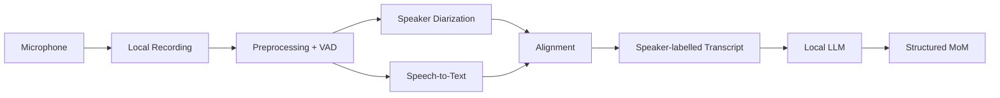

<div align="center">


# Cadence

**Local-first meeting transcription and minutes-of-meeting, entirely on your laptop.**

No cloud STT. No cloud LLM. No telemetry. No internet required after setup.

[](LICENSE)
[](#building-from-source)
[](#project-status)
[](https://tauri.app)
[](https://www.rust-lang.org)
[](#contributing)

[Features](#features) · [How it works](#how-it-works) · [Building from source](#building-from-source) · [Docs](#documentation) · [Contributing](#contributing)

</div>

---

Cadence records a physical meeting from a microphone and, on that same machine, turns it into a speaker-labelled transcript and a structured Minutes of Meeting — decisions, action items, open questions, risks. Meeting audio is some of the most sensitive data an organization produces, so the answer here is architectural rather than a privacy policy: the AI runtime is Rust-orchestrated native binaries only, so there is no cloud dependency to misconfigure and no telemetry to opt out of.

It is built for real-world mixed-language meetings: **English, Tamil, and code-switched "Tanglish" within the same sentence** are all first-class, not an afterthought.

## Features

- 🎙️ **Local recording** — enumerate and pick any Windows input device (default mic, USB conference mic, headset), with live level metering and disconnect/clipping warnings.
- 📝 **Local speech-to-text** — multilingual, code-switch-aware transcription via whisper.cpp / sherpa-onnx.
- 🗣️ **Local speaker diarization** — `Person 1`, `Person 2`, … labels without identifying real people.
- 🧠 **Local LLM meeting minutes** — summary, decisions, action items, open questions and risks, each grounded in transcript evidence with timestamps; hallucination controls keep speculation from becoming a "decision".
- 🔍 **Searchable history** — browse past meetings, search within a transcript, jump to any timestamp and replay the audio.
- 📤 **Export** — Markdown and JSON today, PDF/DOCX planned.
- 🧩 **Model management** — install, verify and remove local STT/LLM/diarization models from Settings, with SHA-256 integrity checks.
- ⚖️ **Adapts to your machine** — detects available RAM and picks smaller/faster models and context sizes on a 16 GB laptop, larger ones on a 32 GB machine.

## How it works



Every stage runs as a Rust-orchestrated native process on the same machine — no stage ever makes a network call. Raw artifacts (`original.wav`, `stt.json`, `diarization.json`) are written before the next stage runs and kept separate from derived output, so a late failure never costs earlier work.

## Tech stack

| Layer | Choice |
|---|---|
| Desktop shell | [Tauri 2](https://tauri.app) |
| UI | React 19 + TypeScript + Vite |
| Native layer | Rust (audio capture via `cpal`, process orchestration, SQLite storage) |
| Speech-to-text | [whisper.cpp](https://github.com/ggml-org/whisper.cpp) / [sherpa-onnx](https://github.com/k2-fsa/sherpa-onnx) |
| Speaker diarization | ONNX-based offline diarization (sherpa-onnx) |
| Meeting minutes | [llama.cpp](https://github.com/ggml-org/llama.cpp), local GGUF models (Qwen3, Gemma 3 candidates) |

No Python, PyTorch, Docker or WSL — at development time or at runtime. [docs/architecture.md](docs/architecture.md) has the reasoning behind each decision.

## Building from source

Cadence targets **Windows 11 (x64)**. Everything below runs in PowerShell from the repository root.

### 1. Prerequisites

| Requirement | Notes |
|---|---|
| **Windows 11 (x64)** | Windows 10 21H2+ likely works but is untested |
| **Node.js 20 LTS or newer** | [nodejs.org](https://nodejs.org) — ships the `npm` used below |
| **Rust (stable, MSVC toolchain)** | Install via [rustup](https://rustup.rs); confirm with `rustup default stable-x86_64-pc-windows-msvc` |
| **Microsoft C++ Build Tools** | [Visual Studio Build Tools](https://visualstudio.microsoft.com/visual-cpp-build-tools/) with the *Desktop development with C++* workload — required by the MSVC linker and by `rusqlite`'s bundled SQLite |
| **WebView2 Runtime** | Preinstalled on Windows 11; otherwise [download it](https://developer.microsoft.com/microsoft-edge/webview2/) |

Verify with `node --version` (v20 or newer), `cargo --version` and `rustc --version` before building.

### 2. Clone and install

```powershell
git clone https://github.com/karthik1710/Cadence.git
cd Cadence
npm install
```

The first `cargo` build compiles the whole Tauri dependency tree and takes several minutes; later builds are incremental.

### 3. Install the AI models

Cadence ships **no model weights** — the installer stays small, and weights are installed as data files afterwards. Either launch the app and use **Settings → Model Manager** (recommended; it downloads, SHA-256-verifies and installs each model), or run the dev-time script:

```powershell
.\scripts\setup-models.ps1
```

Both install into `%APPDATA%\com.cadence.app\models\` (`bin\`, `stt\`, `llm\`, `diarization\`), the same location the shipped app resolves at runtime. The script is safe to re-run; every step is skipped if its output already exists. This is the only step that needs an internet connection — after it completes, the app runs fully offline.

### 4. Run in development

```powershell
npm run tauri dev        # full desktop app: Vite on :1420 + the Rust backend
npm run dev              # frontend only — no Tauri APIs available
```

### 5. Build a production bundle

```powershell
npm run tauri build
```

Artifacts land in `src-tauri/target/release/`: `Cadence.exe`, plus `bundle/msi/Cadence_0.1.0_x64_en-US.msi` and `bundle/nsis/Cadence_0.1.0_x64-setup.exe`. The release profile uses `opt-level = 3`, LTO and a single codegen unit, so a clean release build is noticeably slower than a debug one; it is also the profile the processing-time budget in [docs/benchmarks.md](docs/benchmarks.md) assumes.

### 6. Checks and headless tools

```powershell
npm run build                 # tsc typecheck + production frontend build

cd src-tauri
cargo build                   # Rust-only build
cargo test                    # Rust unit tests (pipeline modules)

# headless pipeline run: audio → preprocess → diarize → STT → align → MoM
cargo run --bin pipeline_cli -- <audio.wav> [out-dir]

# benchmark harness; prints Markdown tables for docs/benchmarks.md
cargo run --release --bin bench_cli -- <stt|diarize|llm|full> <input> [options]
```

There is no ESLint/Prettier config and no JS test runner: `npm run build` is the frontend check, `cargo test` the backend one.

### Troubleshooting

| Symptom | Fix |
|---|---|
| `link.exe not found`, or linker errors | Install the *Desktop development with C++* workload in Visual Studio Build Tools |
| `cargo run` can't determine which binary to run | The crate has multiple binaries; `Cargo.toml` sets `default-run = "app"` — don't remove it |
| App starts but every pipeline stage errors | Models aren't installed — run the Model Manager or `scripts\setup-models.ps1` |
| Long speech collapses into one short line | whisper.cpp must be invoked with `--max-len 80 --split-on-word --max-context 0`; see [docs/benchmarks.md](docs/benchmarks.md) |
| Port 1420 already in use | Another `tauri dev` is running; stop it before starting a new one |

## Project structure

```text
Cadence/
├── src/                    # React UI
├── src-tauri/              # Rust: native commands, audio capture, AI pipeline orchestration
│   ├── src/pipeline/       # preprocess → diarize → STT → align → MoM, plus llm/ providers
│   └── src/bin/            # pipeline_cli, bench_cli
├── public/                 # logo.svg (vector master) + logo.png (the shipped mark)
├── scripts/                # setup-models.ps1 (dev-time model fetch)
├── docs/                   # architecture, benchmarks, roadmap — living decision docs
├── CLAUDE.md / AGENTS.md   # standing instructions for coding agents
└── LICENSE
```

`public/logo.png` is the single raster every surface renders — this README, the in-app header mark, the webview favicon, and the Windows app/installer icons in `src-tauri/icons/`. After editing the `public/logo.svg` master, regenerate them with `npx tauri icon` so nothing drifts.

## Privacy

- Audio, transcripts and minutes are written only to `%APPDATA%\com.cadence.app\` on the recording machine.
- The crate links no HTTP client. The two narrow exceptions are documented and auditable: `curl.exe`/`tar.exe` shellouts for one-time model downloads, and a hand-rolled **loopback-only** client that drives the local `llama-server.exe`.
- No analytics, no crash reporting, no update pings.

What is captured, what is logged, how deletion works and how model integrity is verified are detailed in [docs/architecture.md](docs/architecture.md).

## Project status

**Pre-alpha, actively in development.** The full local pipeline — recording, STT, diarization, alignment, MoM generation, history, export and model management — is implemented and adapts its model choices to the machine's available RAM. The crate builds clean and its 240 Rust unit tests pass. What is still open: the STT/diarization/LLM model and threshold choices remain provisional, pending benchmarks on this project's own (including Tamil/Tanglish) audio that have never been executed — the harness exists, the numbers do not. Nothing here is ready to run an unattended meeting yet. [docs/roadmap.md](docs/roadmap.md) tracks status, open risks and the backlog.

## Documentation

| Doc | Purpose |
|---|---|
| [docs/architecture.md](docs/architecture.md) | How the app is built, plus the privacy and data-handling model |
| [docs/benchmarks.md](docs/benchmarks.md) | Model choices, measured performance, what is not yet measured, and how to run the `bench_cli` harness |
| [docs/roadmap.md](docs/roadmap.md) | Status, open risks and backlog |

[CLAUDE.md](CLAUDE.md) and [AGENTS.md](AGENTS.md) are the standing instructions for coding agents working in this repo.

## Contributing

Contributions are welcome, especially around STT/diarization benchmarking, multilingual (Tamil/Tanglish) test audio, and the local LLM pipeline.

1. **Open an issue first** for anything beyond a small fix, so the approach can be discussed before code is written.
2. **Keep the runtime cloud-free:** no calls to any hosted AI API from the shipped app, and no Python/PyTorch in the AI pipeline — native binaries only (see [docs/architecture.md](docs/architecture.md)).
3. **Never lose a meeting:** every failure path must surface a visible, recoverable error and preserve raw artifacts (`original.wav`, `stt.json`, `diarization.json`) separately from derived output.
4. **Never commit confidential recordings** or real meeting content.
5. **Before opening a PR,** run `npm run build` and `cargo test`, and state the results in the PR description.

## License

[MIT](LICENSE) © 2026 Karthik Palani
